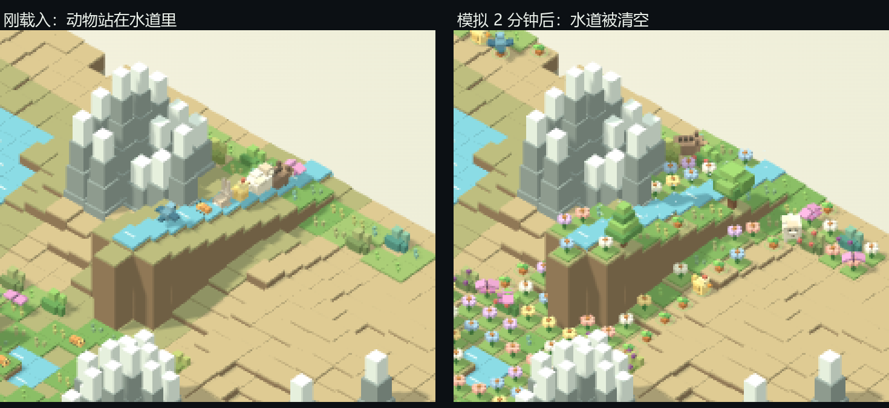

# 涌现式玩法（第一例：水流冲走小动物）

目标：玩法不再靠"给每种动物写一条规则"，而是**给所有动物一套属性**，让它们和环境属性自己相撞出结果。
第一个例子就是水的流动。



左：刚载入演示存档，动物站在水道里。右：模拟 2 分钟后，**水道被清空**，会飞的还在。

## 一、动物属性（`src/data/species.js` 的 `TRAITS`）

| 属性 | 取值 | 作用 |
| --- | --- | --- |
| `move` | `walk` 走 / `fly` 飞 / `swim` 游 | 会飞的不受水冲；会游的更难被冲 |
| `mass` | 0.3 ～ 6（蝴蝶最轻，野猪最重） | 体重越大越抗冲 |
| `climb` | 0 ～ 3 | 一次能爬多高的坎（`0.4 + climb×0.6` 格）；会飞的直接越过 |
| `diet` | `plant` / `insect` / `nectar` / `meat` / `larva` | 食性，决定它算食草、食虫还是授粉者 |
| `plants` | `['seed', ['grass',12], ['bush',80], ['tree',0,'nibble']]` | 吃什么植物、要长到什么状态 |
| `eats` | `['bug']` / `['rabbit','sheep',…]` | 能吃什么动物（不写就是不吃动物） |

15 种动物各自一组，代码里**不再有**"某某动物要被水冲走""某某动物吃不吃草"这类分支。

而且下面这些原本写死的名单，现在全部由属性推出：

```js
const byDiet = d => Object.keys(TRAITS).filter(k => TRAITS[k].diet === d);
const HERBS = byDiet('plant'), HUNTERS = byDiet('insect'), POLLINATORS = byDiet('nectar');
const PREY = {};  // 由每个物种的 eats 汇总
```

改一个物种的 `diet`，它就会自动从"食草者"变成"食虫者"；改 `plants`，它的食谱立刻跟着变。
`tests/traits.cjs` 会逐格比对"属性推出的吃法"与"改造前写死的分支"是否完全一致（700+ 个样本、15 个物种）。

## 二、水的属性（每格一个 `flow`）

- 只有**有落差**的水（四周存在比它低 0.28 格以上的邻居，或紧邻岛外）才会流动。
- 流向 = **落差最大的那个方向**（8 个方向里挑，岛外算最低，所以水会自己流出去），也就是"水往最低处流"。
- 方向在**第一次要流**时按当时的地形定下并写进存档，之后不再改变。
- **所以玩家可以自己造水路**：把东边挖低，水就往东流；把bank垫高，水就改道。不需要额外的"引水"工具——放水之后它自己会走。
- 四周都不低的水就是静水，不流（比如湖心、海面）。
- 已知取舍：方向定下后即使地形再改也不重算。要"每次地形变化都重算"，说一声即可（那时 `flow` 会变成每拍推导，不再是存档字段）。

## 三、两者相撞
每 0.5 秒一拍，站在活水上的动物会被判定一次：

```
被推走的概率 = 1.15 ÷ (体重 × 会不会游)
```

- 虫子（0.4）几乎每拍都被冲；兔子（1.5）约 0.77；绵羊（3.2）约 0.36；野猪（6）约 0.19。
- 被推动后，动物获得一段**位移**（体重越轻、位移越长），于是沿着水的流向一格一格滑下去——**这就是"位移属性"**。
- 滑出岛外就回不来了：会记一条"某某被水冲走了"的事件，并计入 `washed` 指标。
- 会飞的动物概率恒为 0，永远冲不走（它们只是从水面上飞过）。

## 四、第二个相撞：坡地与腿脚

水之外，`climb` 也已经和环境接上了：

- 一次能跨过的落差 = `0.4 + climb × 0.6` 格。虫子/兔子只有 1.0 格，绵羊 1.6，鹿与羊驼 2.2。
- 判定只用来看**从哪来**：`climb` 不够就上不去那道坎，于是动物会自己绕路、山脚成为天然的墙。
- 会飞的（鸟、蝴蝶、蜜蜂）直接越过，坡度对它们没有意义。
- 水里不算坡度（被水冲着走的动物不挑路）。
- 迁入、繁殖这类"凭空找位置"的判定不做坡度检查，避免动物被卡死。

`tests/traits.cjs` 里有一条护栏：随机地形上被坡度挡住的相邻格必须少于 20%，防止以后调参数把岛切成迷宫。

## 五、存档兼容

- 新增格字段 `flow`（0=静水，1..8=方向）；新增动物字段 `drift`（剩余位移拍数）与 `driftDir`（位移方向）。
- 属性（`move/mass/climb/diet/plants/eats`）是代码里的物种数据，不进存档，所以老存档不会因此失效。
- 老存档没有 `flow/drift` 字段：按静水、无位移处理，照旧能打开、继续玩、再保存。
- 越界值（比如 `flow: 9`）会被存档校验直接拒绝。

## 六、怎么自己看

**导入演示存档**：`npm run dev` 打开 <http://127.0.0.1:8877/>，右上「存档」→「导入」→ 选 `docs/水流演示.json`。
按 **Ctrl+F5** 先刷新一次，然后就能看到：

1. 岛上有一条从高处通向岛外的**阶梯水道**，水面上的亮色水纹会朝固定方向移动；
2. 水道里站着虫子、兔子、鸡、绵羊、野猪（走兽），还有鸟和蝴蝶（会飞）；
3. 等十几秒到一两分钟：走兽一只只被冲下去消失，**鸟和蝴蝶一直留在原地**；
4. 左下「事件」里会记下"某某被水冲走了"。

也可以重新生成这份演示：`npm run demo:water`。

## 七、验证

```bash
npm test   # 50 项：22 行为 + 2 渲染 + 5 引导 + 11 形态/渲染 + 6 涌现式水流 + 4 属性化
```

- `tests/flow.cjs`：有落差的水会定下方向且不再改变、静水不流、走兽被冲走而会飞的不会、
  体重越大越抗冲、流向下标与位移属性能够存档且越界被拒。
- `tests/traits.cjs`：名单与捕食关系必须由属性推出且与旧版一致、吃植物的判定与改造前**逐格完全一致**
  （700+ 样本 × 15 物种）、陡坡挡住腿脚差的但挡不住会飞的、坡度封锁的相邻格少于 20%。
- 长时种群观察（3 个种子 × 3000 秒）：终点动物 180 / 166 / 202，植被 924～927，物种 14～15，
  与属性化之前（196 / 214 / 172）同一量级，没有崩也没有爆发。

真实浏览器实测（Edge 无头 + 演示存档）：水里站的动物从 **7 只 → 0 只**，累计被冲走 4 只，
其余会飞的与岸上的动物都留在岛上；水道 11 格全部获得固定流向，其余 47 格静水保持 0。

## 八、下一步：完整的属性化清单

"把脚本式行为一条条换成属性 × 环境"的完整清单（含"喝醉的羊"这条链的设计样板、每条改动的验收配方、
分批次顺序与踩过的坑）单独写在 [`属性化清单.md`](属性化清单.md) 里。要点：

- 动物、**植物（格子）**、**环境（格子）** 三类东西都可以有属性——你举的"羊驼吐口水沾到草让羊醉"就同时用了这三类。
- 顺序上先把 `core.js` 里剩下的约 17 处 `a.type==='某某'` 分支清成属性（纯重构、用等价性测试守住），再上新玩法。
- 每一条都先用"改造前后逐格一致"的等价性测试当安全网，再写新行为测试。
